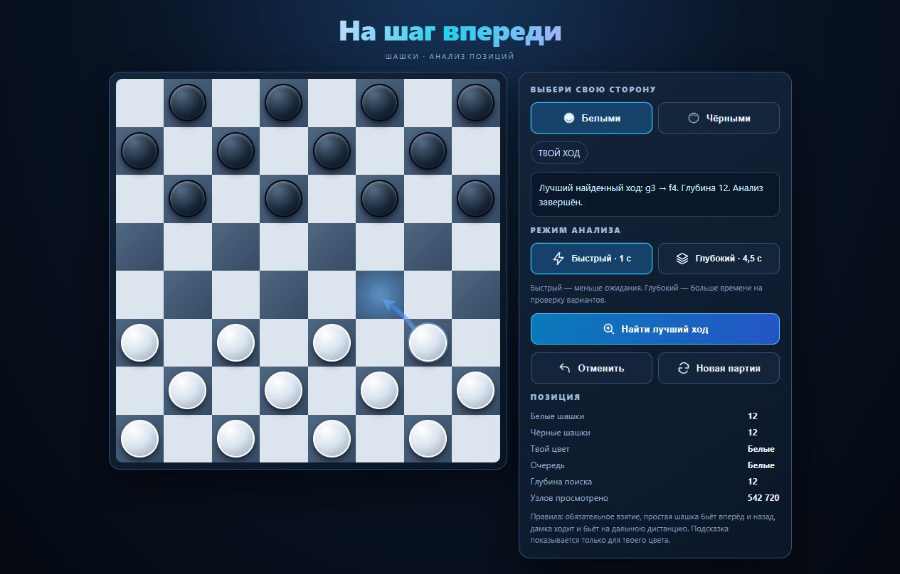

<div align="center">


# На шаг впереди

### Сначала рассчитай. Потом ходи.

Читы для русских шашек — в браузере и внутри Telegram.

**[Telegram · @shashkamovebot](https://t.me/shashkamovebot)** &nbsp; · &nbsp; **[Открыть веб-версию](https://mapkee.github.io/one-step-ahead/)**


</div>



## Будь на ход дальше

Выбери свой цвет, переноси ходы соперника на доску и получай подсказки.
Полупрозрачная синяя стрелка показывает маршрут, а панель — завершённую
глубину поиска и число просмотренных узлов. Стрелка появляется один раз — после завершения поиска.

| Возможность | Как это работает |
| :--- | :--- |
| Два режима поиска | Быстрый — около 1 секунды; глубокий — около 4,5 секунды |
| Стабильная подсказка | Стрелка показывает результат завершённого поиска без перескакивания |
| Наглядный маршрут | Стрелка и отметки промежуточных клеток для серии взятий |
| Удобная доска | Выбор цвета, разворот доски, отмена хода и новая партия |
| Отзывчивый интерфейс | Поиск выполняется в отдельном Web Worker |
| Мобильный формат | Адаптивная вёрстка и подключённый Telegram WebApp SDK |

Быстрый режим может проверить меньше вариантов и уступать глубокому по качеству.
Во время поиска показывается прогресс; стрелка появляется после его завершения.

## Начать

1. Открой [веб-версию](https://mapkee.github.io/one-step-ahead/) или [бота в Telegram](https://t.me/shashkamovebot).
2. Выбери, за какой цвет играешь.
3. Записывай ходы на доске. После хода соперника анализ запустится автоматически.
4. Выбери подсвеченную шашку и клетку назначения, чтобы записать свой ход.
   В серии взятий нажимай каждую клетку приземления по очереди. До завершения
   серии очередь не меняется; «Отменить» возвращает всю комбинацию.

## Под капотом

Чистые HTML, CSS и JavaScript. Сборка и отдельный сервер для анализа не нужны:
движок работает на устройстве пользователя.

Поиск использует итеративное углубление, negamax с alpha-beta отсечениями,
таблицу транспозиций, упорядочивание ходов и поиск взятий на границе глубины.

```text
index.html          Интерфейс и интеграция с Telegram
engine-worker.js    Поисковый движок
docs/screenshot.jpg Скриншот приложения
tests/              Проверки движка и интерфейса
```

Для локального запуска размести файлы на HTTP-сервере с поддержкой статических
файлов. Открытие через `file://` может блокировать загрузку Web Worker.

## Проверки

Нужны Node.js и Git. Из корня репозитория:

```sh
node tests/engine.cjs
node tests/ui.cjs
```

Проверяются совпадение генерации ходов с исходным движком, результаты поиска
при фиксированной глубине, частичные ответы, переключение режимов и отмена
устаревшего анализа. Подробности — в [описании проверок](tests/README.md).

---

<div align="center">

**На шаг впереди · One Step Ahead**  
[Telegram](https://t.me/shashkamovebot) · [Веб-версия](https://mapkee.github.io/one-step-ahead/)

</div>
